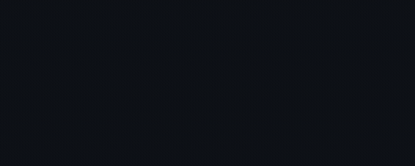
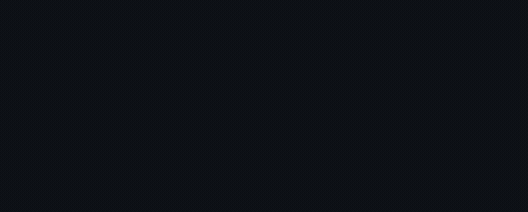

# BlankUpdater

A MelonLoader plugin for ChilloutVR that keeps my mods and plugins up to date from my own download server, for mods that are not on the CVR Modding Group

## What it does

- When the game starts, it loads the update list from `download.blankinternational.com`
- It reads the version of every installed mod straight from its `MelonInfo`, without loading the DLL
- If the server has a newer version, it downloads it, checks the SHA256 checksum and replaces the old DLL before ChilloutVR loads its mods
- Mods that are not on the server are never touched. Neither are mods with the same name by a different author
- Plugins (including BlankUpdater itself) are updated too. They are already loaded at that point, so the new version is used on the next start
- If the server can't be reached, the game simply starts as usual
- While it checks and downloads, a small window shows what is happening and how far the download is

| Everything up to date | Server not reachable |
|---|---|
|  |  |

## Installation

1. Put `CVRModUpdater.BlankLoader.dll` into `ChilloutVR\Plugins` (not `Mods`)
2. Start the game once. The settings are created in `ChilloutVR\UserData\MelonPreferences.cfg`

## Quick menu page

With [BTKUILib](https://github.com/BTK-Development/BTKUILib) installed, BlankUpdater gets its own page in the quick menu:

- The result of the last check
- Channel Stable or Beta for all mods, check at start, progress window, plugin updates and step time
- Every installed mod from the server with its installed, Stable and Beta version. Tap it to choose its own channel: Default, Stable, Beta or Don't update
- A button that opens the download page

Changes are saved right away and used at the next game start, because updates are installed before the mods load. Without BTKUILib everything works the same, only the page is missing

## Settings

All settings are in the `[BlankUpdater]` section of `MelonPreferences.cfg`. The quick menu page changes the same values

| Setting | Default | Meaning |
|---|---|---|
| `Enabled` | `true` | Check for updates when the game starts |
| `Channel` | `"Stable"` | `Stable` or `Beta`. Beta also gets a Stable release if it is newer than the latest beta |
| `ChannelOverrides` | `""` | Channel per mod, for example `"MP3toMP4=Beta, SizeScaledMovement=Stable"` |
| `Ignored` | `""` | Mods that are never updated, for example `"AdvActionMenu"` |
| `UpdatePlugins` | `true` | Also update plugins |
| `ShowWindow` | `true` | Show the progress window during the check |
| `MinStepSeconds` | `2` | How long each step (checking, every download, the result) stays visible in the window. `0` = as fast as possible |
| `ManifestUrl` | the Blank International manifest | Where the list of versions comes from |
| `DownloadUrl` | the Blank International downloads | Base address the files in the list are relative to |

## Versions

Versions are compared like `0.3.0 < 0.3.1 < 0.4.0`. A pre-release such as `0.3.0-beta.4` counts as older than `0.3.0`

If the installed version is the same as on the server but the file is different, nothing is replaced and the log shows a warning. Raise the version number in `MelonInfo` before every upload. A local build that is newer than the server is kept

## Building

Run `build.bat` or `dotnet build -c Release`. The DLL goes straight into `ChilloutVR\Plugins`. If ChilloutVR is not installed at `D:\SteamLibrary\steamapps\common\ChilloutVR`, set the `CVRPATH` environment variable or change the path in `BlankUpdater.csproj` and `build.bat`
